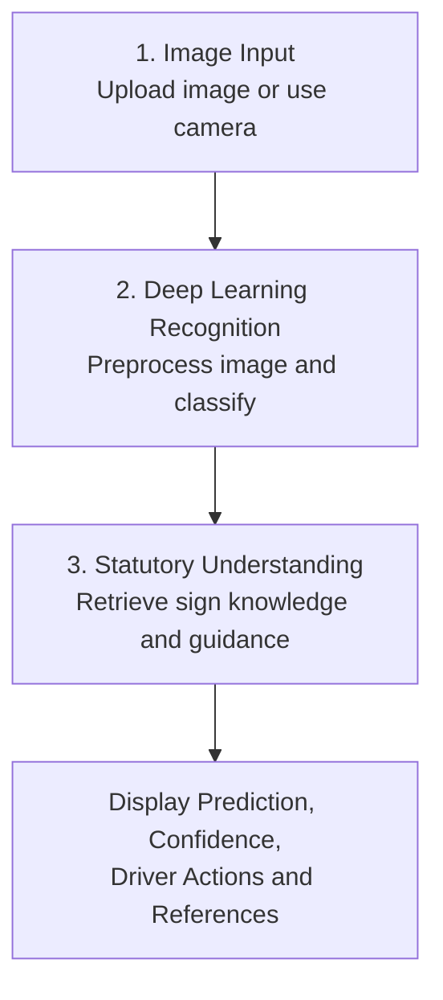
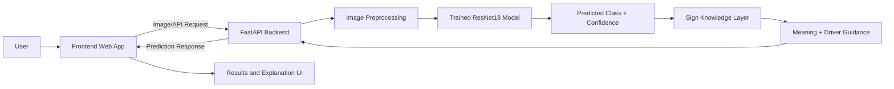

<div align="center">

# 🚦 Traffic Sign Saarthi AI

### Understand Every Sign. Drive Safer Across India.

**An AI-powered Indian traffic sign recognition and road-safety assistant**

<p>
  <a href="https://traffic-sign-frontend-9huw.onrender.com/"><strong>🌐 Live Demo</strong></a> ·
  <a href="https://traffic-sign-backend-49u0.onrender.com/api/health"><strong>⚙️ API Status</strong></a> ·
  <a href="https://github.com/Purvijain1234/Traffic-Sign-Prediction-LLM"><strong>💻 Source Code</strong></a> ·
  <a href="https://www.kaggle.com/datasets/sarangdilipjodh/indian-traffic-signs-prediction85-classes"><strong>📚 Dataset</strong></a>
</p>


<br/>

| 🛑 85 Indian Sign Classes | 🧠 ResNet18 Classifier | 📊 87.58% Test Accuracy | ⚖️ Road-Safety Explanations |
|:---:|:---:|:---:|:---:|

</div>

---

## 👀 Project Preview

> Explore the interface: upload a traffic-sign image, view the model prediction, and inspect the sign explanation and recommended driver actions.

<table>
  <tr>
    <td width="50%" align="center">
      <strong>🏠 Home Page</strong><br/>
      
    </td>
    <td width="50%" align="center">
      <strong>🛣️ Road Scene</strong><br/>
      
    </td>
  </tr>
  <tr>
    <td width="50%" align="center">
      <strong>✨ Core Capabilities</strong><br/>
      
    </td>
    <td width="50%" align="center">
      <strong>🔍 Sign Detection</strong><br/>
      
    </td>
  </tr>
  <tr>
    <td width="50%" align="center">
      <strong>🤖 AI Explanation</strong><br/>
      
    </td>
    <td width="50%" align="center">
      <strong>⚙️ How It Works</strong><br/>
      
    </td>
  </tr>
</table>

---

## 📌 Table of Contents

- [About the Project](#-about-the-project)
- [Features](#-features)
- [How It Works](#-how-it-works)
- [Machine Learning Models](#-machine-learning-models)
- [Model Evaluation](#-model-evaluation)
- [Dataset](#-dataset)
- [Technology Stack](#-technology-stack)
- [System Architecture](#-system-architecture)
- [Local Installation](#-local-installation)
- [Deployment](#-deployment)
- [API Information](#-api-information)
- [Road-Safety Standards](#-road-safety-standards)
- [Project Structure](#-project-structure)
- [Limitations](#-limitations)
- [Future Improvements](#-future-improvements)
- [Contributing](#-contributing)

## 🚀 About the Project

**Traffic Sign Saarthi AI** is a web-based intelligent road-safety assistant developed to recognize Indian traffic signs and make their meaning easier to understand.

The project combines a deep-learning image classifier with a sign-knowledge and explanation experience. A user can provide a traffic-sign image, view the predicted category and confidence, and explore the sign's meaning, recommended driver actions, road-safety context, and related statutory references shown by the application.

The recognition system evaluates four deep-learning architectures and uses **ResNet18**, which achieved the best reported test accuracy of **87.58%** across **85 Indian traffic-sign classes**.

### 🎯 Project Objectives

- Build an image-based system for classifying Indian traffic signs.
- Compare different deep-learning architectures for recognition performance.
- Present prediction confidence and alternative class hypotheses.
- Explain the meaning and practical importance of recognized signs.
- Provide a simple, accessible web interface for road-safety learning.

> [!IMPORTANT]
> This is an educational and informational prototype. It is not a certified driver-assistance system and must not replace official road signs, traffic authorities, applicable law, or safe driving judgment.

## ✨ Features

<table>
<tr>
<td width="50%" valign="top">

### 🔍 Traffic Sign Recognition
- Recognizes images across 85 Indian sign categories.
- Image upload through the detection interface.
- Live-camera option in the interface.
- Predicted class and confidence score.
- Ranked alternative predictions when available.

</td>
<td width="50%" valign="top">

### 🤖 AI-Assisted Explanations
- Explains what a detected sign means.
- Suggests recommended driver actions.
- Presents road-safety context.
- Shows statutory information and citations where available.
- Provides follow-up question prompts.

</td>
</tr>
<tr>
<td width="50%" valign="top">

### 📊 Model Transparency
- Displays the active model.
- Shows model evaluation accuracy.
- Separates per-image confidence from test accuracy.
- Presents top model hypotheses.

</td>
<td width="50%" valign="top">

### 🧭 Sign Knowledge Explorer
- Searchable list of sign categories.
- Sign class and geometry information where available.
- Explore sign information beyond a single prediction.

</td>
</tr>
</table>

### 🌙 User Interface
- Responsive, section-based web interface.
- Home, Features, Detection, AI Explanation, How It Works, and About navigation.
- Light/dark theme control.
- Dedicated prediction and explanation views.

## 🔄 How It Works

The application follows a three-stage pipeline:



| Stage | Module | What happens |
|:---:|---|---|
| 01 | Image Input | The user uploads a traffic-sign image or uses the available camera interface. |
| 02 | Recognition | The backend preprocesses the image and runs the trained classification model. |
| 03 | Understanding | Sign-specific information is used to present meaning, driver actions, and available road-safety references. |

## 🧠 Machine Learning Models

Four architectures were implemented and evaluated to compare different approaches to image classification.

| Model | Overview | Project Role |
|---|---|---|
| **Custom CNN** | Convolutional neural network designed as a baseline. | Baseline |
| **MobileNetV2** | Lightweight architecture designed for efficient inference. | Efficient model comparison |
| **ResNet18** | Residual network using skip connections to support feature learning. | **Selected best-performing model** |
| **EfficientNet-B0** | Convolutional architecture using compound scaling. | Architecture comparison |

### 🏆 Selected Model - ResNet18

ResNet18 achieved the highest reported test accuracy among the four evaluated models.

<div align="center">

| Metric | Result |
|:---|:---:|
| Test Accuracy | **87.58%** |
| Macro Precision | **74.27%** |
| Macro Recall | **72.84%** |
| Macro F1-score | **72.25%** |
| Weighted F1-score | **87.33%** |
| Number of Classes | **85** |

</div>

**Understanding the scores:** test accuracy is an aggregate metric measured across the test dataset. The confidence shown for an individual uploaded image is a separate prediction score; it does not mean the model is that accurate on every image.

## 📈 Model Evaluation

The following table summarizes the reported evaluation results.

| Model | Accuracy | Macro Precision | Macro Recall | Macro F1 | Weighted F1 |
|---|---:|---:|---:|---:|---:|
| Custom CNN | 71.82% | 56.93% | 54.99% | 52.68% | 77.27% |
| MobileNetV2 | 87.17% | 71.04% | 70.50% | 69.34% | 87.17% |
| **ResNet18** | **87.58%** | **74.27%** | **72.84%** | **72.25%** | **87.33%** |
| EfficientNet-B0 | 82.69% | 65.65% | 64.48% | 63.48% | 82.31% |

### Key Observations

- **ResNet18** achieved the best reported accuracy and macro F1-score.
- **MobileNetV2** performed closely to ResNet18 and is a useful lightweight comparison.
- **EfficientNet-B0** achieved moderate performance in this experiment.
- **Custom CNN** provides a baseline for comparing deeper architectures.
- The difference between macro and weighted metrics is important because class distribution is imbalanced.

## 🗂️ Dataset

The project uses the [Indian Traffic Signs Prediction — 85 Classes dataset](https://www.kaggle.com/datasets/sarangdilipjodh/indian-traffic-signs-prediction85-classes) hosted on Kaggle.

### Dataset Summary

| Dataset Property | Value |
|---|---:|
| Number of classes | **85** |
| Training images before split | 4,438 |
| Test images | 1,288 |
| Training class folders | 85 |
| Test class folders | 85 |
| Minimum images in a training class | 2 |
| Maximum images in a training class | 242 |
| Mean images per training class | 52.21 |
| Median images per training class | 26 |

### Dataset Split

| Split | Images | Classes |
|---|---:|---:|
| Training | 3,551 | 85 |
| Validation | 887 | 85 |
| Testing | 1,288 | 85 |
| **Total** | **5,726** | **85** |

### Dataset Notes
- All three splits contain 85 classes.
- The number of images varies significantly between classes.
- The dataset itself is not included in this repository; download it from Kaggle and follow the directory structure expected by the training code.
- Respect the dataset provider's license and attribution requirements.

## 🧰 Technology Stack

| Layer | Technology | Purpose |
|---|---|---|
| Language | Python | Model training and backend logic |
| Deep Learning | Tensorflow/Keras | Model implementation and inference |
| Computer Vision | OpenCV | Image processing |
| Architectures | CNN, MobileNetV2, ResNet18, EfficientNet-B0 | Model comparison |
| Backend | FastAPI | API and inference service |
| ASGI Server | Uvicorn | Runs the backend |
| Frontend | React-based application | User interface |
| Frontend Tooling | Vite | Frontend development and build |
| Deployment | Render | Hosting frontend and backend |
| Dataset | Kaggle | Indian traffic-sign image data |

## 🏗️ System Architecture



### Main Components

- **Frontend:** navigation, image input, camera interface, prediction display, and explanation views.
- **Backend:** API request handling, image processing, model inference, and response generation.
- **Recognition Model:** classifies input images into one of the 85 supported sign categories.
- **Sign Knowledge Layer:** provides sign descriptions, driver guidance, and statutory context used by the interface.

## 💻 Local Installation

<details>
<summary><strong>1. Prerequisites</strong></summary>

- Python 3.10 or a compatible version supported by the dependencies.
- Node.js and npm.
- Git.
- Webcam (optional, for testing the camera interface).
- CUDA-compatible GPU (optional; CPU inference may be slower).

</details>

<details>
<summary><strong>2. Clone the repository</strong></summary>

```bash
git clone https://github.com/Purvijain1234/Traffic-Sign-Prediction-LLM.git
cd Traffic-Sign-Prediction-LLM
```

</details>

<details>
<summary><strong>3. Set up the backend</strong></summary>

Create a virtual environment:

```bash
python -m venv venv
```

Activate it on Windows:

```powershell
venv\Scripts\activate
```

Activate it on macOS/Linux:

```bash
source venv/bin/activate
```

Install dependencies:

```bash
pip install -r requirements.txt
```

</details>

<details>
<summary><strong>4. Configure model weights and environment</strong></summary>

Place trained model weights in the path expected by the backend configuration. Large datasets and model files may be managed separately from the source repository.

For local frontend development, configure the backend base URL using the environment variable name actually read by the frontend source. For example, if the frontend uses `VITE_BACKEND_URL`, a local `.env.local` can contain:

```env
VITE_BACKEND_URL=http://127.0.0.1:8001
```

Do not put private API keys in frontend environment variables. Any variable bundled into a browser frontend must be treated as public.

</details>

<details>
<summary><strong>5. Run the backend</strong></summary>

From the repository root:

```bash
python -m uvicorn backend.app:app --host 127.0.0.1 --port 8001 --reload
```

Backend base URL:

```text
http://127.0.0.1:8001
```

Health check:

```text
http://127.0.0.1:8001/api/health
```

</details>

<details>
<summary><strong>6. Run the frontend</strong></summary>

Open a second terminal:

```bash
cd Frontend
npm install
npm run dev
```

Open the local development URL printed by Vite.

</details>

## ☁️ Deployment

The live application is hosted on Render.

### Backend — Render Web Service

| Setting | Configuration |
|---|---|
| Build command | `git lfs install && git lfs pull && pip install -r requirements.txt` |
| Start command | `uvicorn backend.app:app --host 0.0.0.0 --port $PORT` |
| Health endpoint | `/api/health` |

### Frontend — Render Static Site

| Setting | Configuration |
|---|---|
| Root directory | `Frontend` |
| Build command | `npm install && npm run build` |
| Publish directory | `dist` |
| Backend URL | Set the frontend API-base variable to the deployed backend URL |

**Live links**

- Frontend: https://traffic-sign-frontend-9huw.onrender.com/
- Backend: https://traffic-sign-backend-49u0.onrender.com
- Health: https://traffic-sign-backend-49u0.onrender.com/api/health

> Render services on a free tier may take a short time to wake up after inactivity.

## 🔌 API Information

The publicly confirmed backend health endpoint is:

```http
GET /api/health
```

Live endpoint: [Backend Health Check](https://traffic-sign-backend-49u0.onrender.com/api/health)

The frontend communicates with the backend for image classification and related information. For exact route names, request formats, and response schemas, refer to the current `backend/app.py` implementation or the API documentation exposed by the running service. This README intentionally does not guess undocumented endpoint contracts.

## ⚖️ Road-Safety Standards

The application interface presents road-sign information with references to Indian road-safety and statutory material, including:

- **IRC:67-2022** — Code of Practice for Road Signs.
- **Motor Vehicles Act, 1988**, including relevant amendments and provisions displayed by the application.

Specific clauses, penalties, and legal interpretations may depend on the sign and circumstances. Always verify legal matters against the latest official publications and competent authorities.

## 📁 Project Structure

Conceptual structure of the main application:

```text
Traffic-Sign-Prediction-LLM/
│
├── backend/
│   ├── app.py
│   └── sign_knowledge.py
│
├── Frontend/
│   ├── src/
│   ├── public/
│   ├── package.json
│   └── ...
│
├── weights/                 # Trained model weights, if stored locally
├── requirements.txt
├── .gitignore
└── README.md
```

The dataset, notebooks, and large model artifacts may be stored separately and excluded from Git.

## ⚠️ Limitations & Responsible Use

- Prediction quality depends on image clarity, lighting, camera angle, distance, and obstruction.
- The dataset may not represent every real-world sign variation or road condition.
- A high confidence score does not guarantee a correct prediction.
- Overall test accuracy does not guarantee the correctness of an individual result.
- Legal information should be checked against current official sources.
- Do not use this prototype as the sole basis for driving decisions or automated vehicle control.

## 🔮 Future Improvements

- Expand and balance the dataset with more real-world road images.
- Improve recognition of blurred, distant, damaged, or partially obstructed signs.
- Benchmark additional lightweight architectures for faster inference.
- Evaluate performance across different lighting and weather conditions.
- Add multilingual explanations for Indian road users.
- Add automated tests for frontend flows and backend API responses.
- Improve accessibility and mobile usability.
- Version model weights and document reproducible training configurations.

## 🤝 Contributing

Contributions and suggestions are welcome.

1. Fork the repository.
2. Create a feature branch.
3. Make and test your changes.
4. Commit with a clear message.
5. Open a pull request describing your changes.

## 📄 License

Add the appropriate `LICENSE` file before presenting the project as open source. Dataset and third-party library terms must also be followed.

---

## Author

**Purvi Jain**

Project: **Traffic Sign Saarthi AI**  
Repository: https://github.com/Purvijain1234/Traffic-Sign-Prediction-LLM

---

<div align="center">

### 🚦 Traffic Sign Saarthi AI

**Making Indian road signs easier to recognize, understand, and follow.**


⭐ If you find this project useful, consider starring the repository.

</div>
